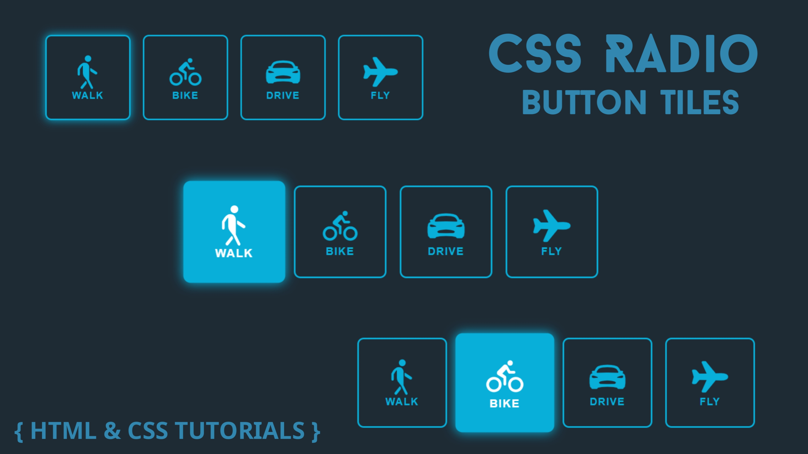

# CSS-Radio-Button-Tiles
Want to create stylish and modern Neon Radio Buttons using only HTML and CSS? In this video, learn how to design beautiful radio button tiles with glowing neon effects and attractive UI styling.

💻 Technologies Used:
01. HTML5
02. CSS3
03. Pure CSS Animations
04. CSS Hover Effects

# HTML Program : -
      <!DOCTYPE html>
      <html lang="en">
            <head>
            <meta charset="UTF-8">
            <meta http-equiv="X-UA-Compatible" content="IE=edge">
            <meta name="viewport" content="width=device-width, 
            initial-scale=1.0">
            <link rel="stylesheet" href="style.css">
            <title>Pure CSS Radio Button Tiles</title>
            </head>
            <body>
            

            

            

               <input id="walk" type="radio" name="radio">
               

                <ion-icon name="walk"></ion-icon>
                <label for="walk">Walk</label>
              

           

          

            <input id="bike" type="radio" name="radio">
          

            <ion-icon name="bicycle"></ion-icon>
            <label for="bike">Bike</label>
          

        

        

          <input id="car" type="radio" name="radio">
          

            <ion-icon name="car-sport"></ion-icon>
            <label for="car">Drive</label>
          

        

        

          <input id="fly" type="radio" name="radio">
          

            <ion-icon name="airplane"></ion-icon>
            <label for="fly">Fly</label>
          

        

      

    

    
      
      </body>
      </html>

# CSS Program : -
     :root {
       --primary-color: #07afd9;
     }

    * {
       box-sizing: border-box;
       font-family: sans-serif;
    }

      body {
         background-color: #1E2B35;
         overflow: hidden;
    }

      .container {
       display: flex;
       justify-content: center;
       align-items: center;
       height: 100vh;
    }

     .radio-tile-group {
       display: flex;
       flex-wrap: wrap;
       justify-content: center;
    }

     .input-container {
       position: relative;
       height: 7rem;
       width: 7rem;
       margin: 0.5rem;
    }

     .input-container input {
        position: absolute;
        height: 100%;
        width: 100%;
        margin: 0;
        cursor: pointer;
        z-index: 2;
        opacity: 0;
    }

     .input-container .radio-tile {
        display: flex;
        flex-direction: column;
        align-items: center;
        justify-content: center;
       height: 100%;
       border: 2px solid var(--primary-color);
       border-radius: 8px;
        transition: all 300ms ease;
    }

     .input-container ion-icon {
        color: var(--primary-color);
        font-size: 3rem;
    }

    .input-container label {
       color: var(--primary-color);
       font-size: 0.80rem;
       font-weight: 600;
       text-transform: uppercase;
       letter-spacing: 1px;
     }

     input:checked+.radio-tile {
        background-color: var(--primary-color);
        box-shadow: 0 0 12px var(--primary-color);
        transform: scale(1.1);
    }

      input:hover+.radio-tile {
          box-shadow: 0 0 12px var(--primary-color);
    }

      input:checked+.radio-tile ion-icon,
      input:checked+.radio-tile label {
      color: white;
    }
